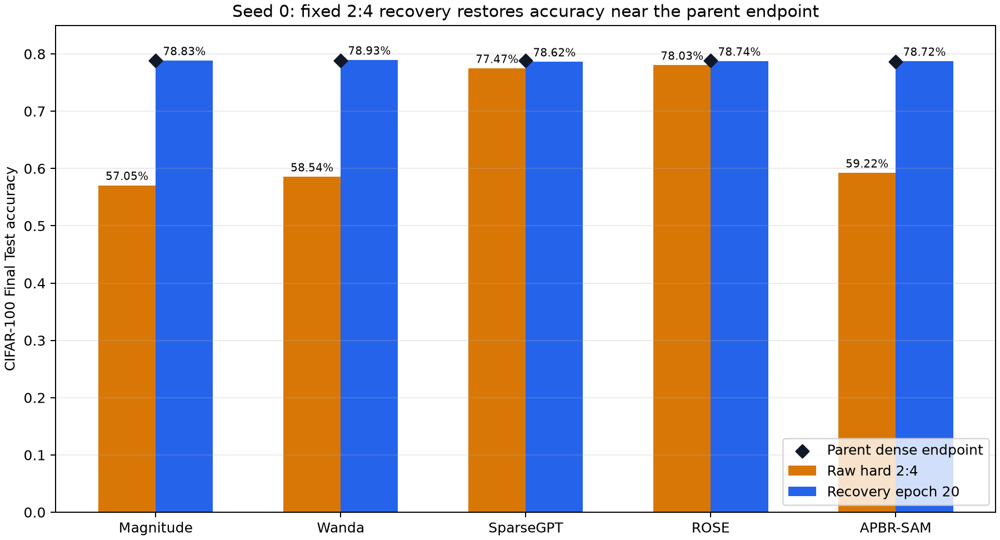

# Seed 0 的五种 2:4 方法均完成，20-epoch Recovery 将准确率恢复至父模型附近

## 结论

- Seed 0 全流程通过：两段 200-epoch 训练、五种 2:4 剪枝、五段固定 20-epoch Recovery，以及 12 项独立 Final Test 均已完成。
- Dense-SAM Final Test 为 **78.84%**；APBR-SAM dense endpoint 为 **78.68%**，相差 **-0.16 pp**。
- 五种方法 Recovery 后均回到各自父模型的 **0.22 个百分点以内**。Seed 0 上 Wanda 最高（**78.93%**），但只比 Dense-SAM 高 **0.09 个百分点（9/10,000 张图片）**，单 seed 不足以支持方法排名或 SOTA 结论。
- 修复后的 APBR 2:4 已完整通过：bool keep-mask、19 个可剪枝层、每个完整四元组恰留 2 个、dense tail、剪枝坐标在 raw/recovery checkpoint 中保持为零，且所有数值 finite。

## Final Test 对比

| 方法 | 父模型 | Raw Hard | Recovery-20 | Recovery 增益 | Recovery 相对父模型 | 剪枝+恢复估计耗时 | 峰值 allocated |
|---|---|---:|---:|---:|---:|---:|---:|
| Magnitude | dense final | 57.05% | 78.83% | +21.78 pp | -0.01 pp | 391.8 s | 1.08 GiB |
| Wanda | dense final | 58.54% | 78.93% | +20.39 pp | +0.09 pp | 399.3 s | 1.58 GiB |
| SparseGPT | dense final | 77.47% | 78.62% | +1.15 pp | -0.22 pp | 410.0 s | 1.08 GiB |
| ROSE | dense final | 78.03% | 78.74% | +0.71 pp | -0.10 pp | 408.3 s | 1.08 GiB |
| APBR-SAM | apbr final | 59.22% | 78.72% | +19.50 pp | +0.04 pp | 356.6 s | 1.09 GiB |

Magnitude、Wanda 和 APBR-SAM 的 raw hard accuracy 降幅较大，但固定 20-epoch Recovery 基本恢复；SparseGPT 和 ROSE 的 raw hard 起点明显更接近 Dense-SAM。这里的“估计耗时”是校准、剪枝和 Recovery 计时之和，不包含独立 Final Test。

## 协议与证据验收

- 数据身份：官方 CIFAR-100 archive SHA256 `85cd44d02ba6437773c5bbd22e183051d648de2e7d6b014e1ef29b855ba677a7`；Train 50,000，Test 10,000；无 validation split。
- 模型身份：`ssam2022_cifar_resnet18_c100_v1`，architecture SHA256 `95367b739c42cca14cb51d1a776e5dbdbe71f9ed4a1afbd2c5c0b1bb994827ea`。
- 训练端点：Dense-SAM 与 APBR-SAM 均为 epoch 200、78,200 steps、`fixed_final_epoch`，训练阶段 `test_accessed=false`。
- Recovery 端点：每种方法均为 epoch 20、7,820 steps，`test_accessed=false`。
- Final Test：12/12 结果为 PASS；每项均使用 10,000 张测试图片，`selection_performed=false`、`hyperparameter_change_performed=false`。
- Mask：五种方法均覆盖 19 个内部可剪枝层；首层、末层、BN affine 和 bias 被排除；所有完整四元组严格 2:4，tail 保持 dense。
- 传输：主清单 87 个文件全部匹配，清单 SHA256 `b2797875200ddf962fabdfcfd3fdbc0ad49cb80444c992735f49fd7bb85c71d1`；证据清单 9 个文件全部匹配。
- 环境：NVIDIA GeForce RTX 4080 SUPER，PyTorch 2.8.0+cu128，CUDA build 12.8。

## 已解决的执行异常

首次 APBR 2:4 调用使用了 positional `argsort` 维度参数，与服务器 PyTorch API 不兼容。最小修复仅将其改为 `dim=-1`，未改变评分、稳定 tie、分组、N:M 或训练参数。修复提交 `d4a6adb9856ff0327b0aeabeec56d5b36fb4f7d7`，实际 postprocess SHA256 `b530ddf6c44e4e7468e3c5cd446b849651114b5c00707025d8d064c57a1592db`。修复前失败证据已保留；为保持方法源码一致，Seed 0 五种剪枝均由修复后源码重新执行。

## 限制与下一步

本报告只分析 Seed 0。Seed 1 和 Seed 2 尚在远端串行执行，因此目前不能报告跨 seed 均值/方差、显著性或正式 SOTA 排名。正式比较应等待三 seed 全部完成，再按完全相同的 Final Test 定义汇总。
