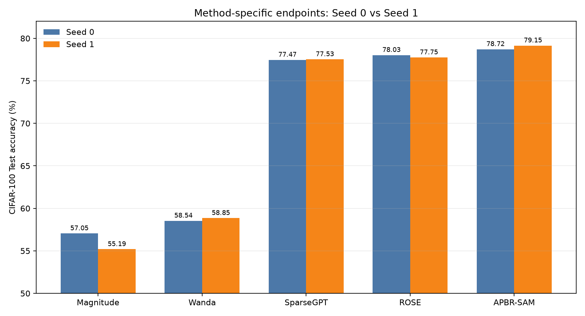

# CIFAR-100 Seed 0/1：方法特定终点与统一 Recovery-20 分析

## 结论

Seed 0 与 Seed 1 的 SparseGPT、ROSE 及 APBR Recovery-20 终点稳定。方法特定主终点中，ROSE Native 与 SparseGPT Native 明显优于 Mask-only 的 Magnitude/Wanda；APBR-SAM 的预注册主终点 Recovery-20 在两个 seed 均约 79%，但它包含额外 20 epochs 恢复成本。

值得注意的是，APBR Raw Hard 从 Seed 0 的 59.22% 降到 Seed 1 的 51.87%（-7.35 pp），而 Recovery-20 终点反而从 78.72% 升至 79.15%（+0.43 pp）：即时几何剪枝表现存在明显 seed 敏感性，但固定 Mask 恢复抹平了大部分差异。两 seed 结果仍是中间分析，正式 mean ± sample SD 必须等待 Seed 2。

## 方法特定主终点

| Seed | Method | Accuracy | CE Loss | Δ vs parent |
|---:|---|---:|---:|---:|
| 0 | Magnitude | 57.05% | 1.6919 | -21.79 pp |
| 0 | Wanda | 58.54% | 1.6310 | -20.30 pp |
| 0 | SparseGPT | 77.47% | 0.8503 | -1.37 pp |
| 0 | ROSE | 78.03% | 0.8231 | -0.81 pp |
| 0 | APBR-SAM | 78.72% | 0.8238 | +0.04 pp |
| 1 | Magnitude | 55.19% | 1.7697 | -23.78 pp |
| 1 | Wanda | 58.85% | 1.6218 | -20.12 pp |
| 1 | SparseGPT | 77.53% | 0.8488 | -1.44 pp |
| 1 | ROSE | 77.75% | 0.8276 | -1.22 pp |
| 1 | APBR-SAM | 79.15% | 0.8145 | +0.07 pp |

## 两 Seed 描述性汇总（Seed 2 尚未完成）

| Method | Accuracy mean ± sample SD | Mean Δ vs parent |
|---|---:|---:|
| Magnitude | 56.12% ± 1.32 pp | -22.79 pp |
| Wanda | 58.70% ± 0.22 pp | -20.21 pp |
| SparseGPT | 77.50% ± 0.04 pp | -1.40 pp |
| ROSE | 77.89% ± 0.20 pp | -1.01 pp |
| APBR-SAM | 78.94% ± 0.30 pp | +0.05 pp |

## APBR Recovery-20 的同 Seed 配对差值

| Seed | Comparison | Difference |
|---:|---|---:|
| 0 | APBR Recovery-20 - Magnitude native | +21.67 pp |
| 0 | APBR Recovery-20 - Wanda native | +20.18 pp |
| 0 | APBR Recovery-20 - SparseGPT native | +1.25 pp |
| 0 | APBR Recovery-20 - ROSE native | +0.69 pp |
| 1 | APBR Recovery-20 - Magnitude native | +23.96 pp |
| 1 | APBR Recovery-20 - Wanda native | +20.30 pp |
| 1 | APBR Recovery-20 - SparseGPT native | +1.62 pp |
| 1 | APBR Recovery-20 - ROSE native | +1.40 pp |

## 补充：统一 Recovery-20

这些结果只用于观察恢复能力，不与方法特定主终点混合排名。

| Seed | Method | Raw | Recovery-20 | Gain |
|---:|---|---:|---:|---:|
| 0 | Magnitude | 57.05% | 78.83% | +21.78 pp |
| 0 | Wanda | 58.54% | 78.93% | +20.39 pp |
| 0 | SparseGPT | 77.47% | 78.62% | +1.15 pp |
| 0 | ROSE | 78.03% | 78.74% | +0.71 pp |
| 0 | APBR-SAM | 59.22% | 78.72% | +19.50 pp |
| 1 | Magnitude | 55.19% | 78.82% | +23.63 pp |
| 1 | Wanda | 58.85% | 78.67% | +19.82 pp |
| 1 | SparseGPT | 77.53% | 78.47% | +0.94 pp |
| 1 | ROSE | 77.75% | 78.50% | +0.75 pp |
| 1 | APBR-SAM | 51.87% | 79.15% | +27.28 pp |

## 审计结论

- Seed 1 的 12 个 Final Test 记录齐全，每项 10,000 样本，未执行选模或超参数变更。
- Dense/APBR 均固定 Epoch 200；五种方法 Recovery 均固定 Epoch 20、7,820 steps。
- 五种方法 Raw Hard 父 checkpoint、Recovery 父 checkpoint、checkpoint SHA256 和评估记录一致。
- 所有方法的 19 层 bool keep-mask 均满足严格 2:4、dense tail；Recovery Mask 未改变，删除权重保持为零。
- Seed 0 与 Seed 1 使用不同 GPU；准确率可按相同冻结协议比较，但运行时间不应作严格硬件无关排名。
- Seed 2 未完成，因此当前两 seed mean ± sample SD 只作描述性中间结果。
