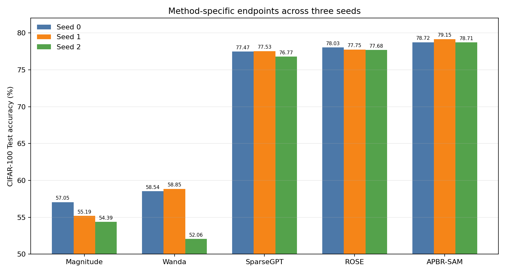

# CIFAR-100 三 Seed：方法特定终点与统一 Recovery-20 分析

## 结论

三 Seed 正式结果显示，SparseGPT Native、ROSE Native 与 APBR Recovery-20 终点较稳定。APBR-SAM Recovery-20 的平均准确率最高，但它包含额外 20 epochs 恢复，因此只能作为完整方法流程对比，不能据此断言几何评分本身优于二阶方法。APBR Raw Hard 在三 Seed 为 59.22%、51.87%、56.14%，跨度 7.35 pp；Recovery-20 后收敛到 78.72%、79.15%、78.71%，跨度仅 0.44 pp，说明即时几何剪枝存在 seed 敏感性，而恢复训练基本抹平了差异。

## 方法特定主终点

| Seed | Method | Accuracy | CE Loss | Δ vs parent |
|---:|---|---:|---:|---:|
| 0 | Magnitude | 57.05% | 1.6919 | -21.79 pp |
| 0 | Wanda | 58.54% | 1.6310 | -20.30 pp |
| 0 | SparseGPT | 77.47% | 0.8503 | -1.37 pp |
| 0 | ROSE | 78.03% | 0.8231 | -0.81 pp |
| 0 | APBR-SAM | 78.72% | 0.8238 | +0.04 pp |
| 1 | Magnitude | 55.19% | 1.7697 | -23.78 pp |
| 1 | Wanda | 58.85% | 1.6218 | -20.12 pp |
| 1 | SparseGPT | 77.53% | 0.8488 | -1.44 pp |
| 1 | ROSE | 77.75% | 0.8276 | -1.22 pp |
| 1 | APBR-SAM | 79.15% | 0.8145 | +0.07 pp |
| 2 | Magnitude | 54.39% | 1.7819 | -24.43 pp |
| 2 | Wanda | 52.06% | 1.8801 | -26.76 pp |
| 2 | SparseGPT | 76.77% | 0.8685 | -2.05 pp |
| 2 | ROSE | 77.68% | 0.8316 | -1.14 pp |
| 2 | APBR-SAM | 78.71% | 0.8110 | -0.32 pp |

## 三 Seed mean ± sample standard deviation

| Method | Accuracy mean ± sample SD | Mean Δ vs parent |
|---|---:|---:|
| Magnitude | 55.54% ± 1.36 pp | -23.33 pp |
| Wanda | 56.48% ± 3.83 pp | -22.39 pp |
| SparseGPT | 77.26% ± 0.42 pp | -1.62 pp |
| ROSE | 77.82% ± 0.19 pp | -1.06 pp |
| APBR-SAM | 78.86% ± 0.25 pp | -0.07 pp |

## APBR Recovery-20 的同 Seed 配对差值

| Seed | Comparison | Difference |
|---:|---|---:|
| 0 | APBR Recovery-20 - Magnitude native | +21.67 pp |
| 0 | APBR Recovery-20 - Wanda native | +20.18 pp |
| 0 | APBR Recovery-20 - SparseGPT native | +1.25 pp |
| 0 | APBR Recovery-20 - ROSE native | +0.69 pp |
| 1 | APBR Recovery-20 - Magnitude native | +23.96 pp |
| 1 | APBR Recovery-20 - Wanda native | +20.30 pp |
| 1 | APBR Recovery-20 - SparseGPT native | +1.62 pp |
| 1 | APBR Recovery-20 - ROSE native | +1.40 pp |
| 2 | APBR Recovery-20 - Magnitude native | +24.32 pp |
| 2 | APBR Recovery-20 - Wanda native | +26.65 pp |
| 2 | APBR Recovery-20 - SparseGPT native | +1.94 pp |
| 2 | APBR Recovery-20 - ROSE native | +1.03 pp |

| Three-seed paired summary | Mean ± sample SD |
|---|---:|
| APBR Recovery-20 - Magnitude native | +23.32 ± 1.44 pp |
| APBR Recovery-20 - ROSE native | +1.04 ± 0.36 pp |
| APBR Recovery-20 - SparseGPT native | +1.60 ± 0.35 pp |
| APBR Recovery-20 - Wanda native | +22.38 ± 3.70 pp |

## 补充：统一 Recovery-20

这些结果只用于观察恢复能力，不与方法特定主终点混合排名。

| Seed | Method | Raw | Recovery-20 | Gain |
|---:|---|---:|---:|---:|
| 0 | Magnitude | 57.05% | 78.83% | +21.78 pp |
| 0 | Wanda | 58.54% | 78.93% | +20.39 pp |
| 0 | SparseGPT | 77.47% | 78.62% | +1.15 pp |
| 0 | ROSE | 78.03% | 78.74% | +0.71 pp |
| 0 | APBR-SAM | 59.22% | 78.72% | +19.50 pp |
| 1 | Magnitude | 55.19% | 78.82% | +23.63 pp |
| 1 | Wanda | 58.85% | 78.67% | +19.82 pp |
| 1 | SparseGPT | 77.53% | 78.47% | +0.94 pp |
| 1 | ROSE | 77.75% | 78.50% | +0.75 pp |
| 1 | APBR-SAM | 51.87% | 79.15% | +27.28 pp |
| 2 | Magnitude | 54.39% | 78.91% | +24.52 pp |
| 2 | Wanda | 52.06% | 78.79% | +26.73 pp |
| 2 | SparseGPT | 76.77% | 78.54% | +1.77 pp |
| 2 | ROSE | 77.68% | 78.82% | +1.14 pp |
| 2 | APBR-SAM | 56.14% | 78.71% | +22.57 pp |

## 审计结论

- 三个 Seed 的 12 个 Final Test 记录均齐全，每项 10,000 样本，未执行选模或超参数变更。
- Dense/APBR 均固定 Epoch 200；五种方法 Recovery 均固定 Epoch 20、7,820 steps。
- 五种方法 Raw Hard 父 checkpoint、Recovery 父 checkpoint、checkpoint SHA256 和评估记录一致。
- 所有方法的 19 层 bool keep-mask 均满足严格 2:4、dense tail；Recovery Mask 未改变，删除权重保持为零。
- Seed 0 与 Seeds 1/2 使用不同 GPU；准确率可按相同冻结协议比较，但运行时间不应作严格硬件无关排名。
- 标准差采用样本标准差（ddof=1）。
