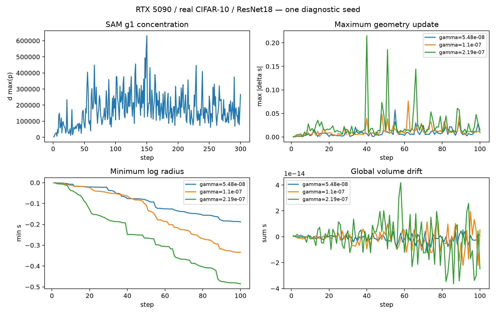

# 固定 Gamma 数值校准

冻结定义没有变化。固定非零梯度下，p=softmax(4s+2log|g|)。固定点要求p_i=1/d，因此s_i=C−(1/2)log|g_i|；sum(s)=0给出C=(1/(2d))sum(log|g|)，即a_i=(prod|g_j|)^(1/(2d))|g_i|^(−1/2)。

Jacobian为I−4gamma d(diag(p)−ppᵀ)。在均匀固定点为I−4gamma(I−11ᵀ/d)，零和子空间特征值1−4gamma；局部渐近稳定需要0<gamma<1/2。整体缩放方向特征值1，但不属于受约束零和空间。

这只适用于固定、有限且各坐标非零的梯度与精确算术、固定d的固定点邻域。零梯度坐标p=0，每步s增加gamma，通常没有上述有限固定点；全零扰动按核心定义跳过。随机梯度使目标固定点移动，不能推导同一全局收敛或长期稳定性。高维集中使单步最大变化接近gamma(d−1)，局部区间不约束这种远离固定点的大跳变。FP32扰动舍入、log-radius存储与体积归约容差须另行验收。

## 实测与提名

采样源为真实CIFAR-10/ResNet18 Dense-SAM的g1；grad=None计零但保留其坐标计入全局d。300步、一个seed，非独立重复；不用SAM原日志中的零占位d_p_max。公共rho0.05、batch128、SGD lr0.1/momentum0.9/weight decay0.0005、Cutout0；所有候选从同seed随机初始化重新开始，不继承SAM或其他候选权重。短程预算在首个epoch内完成，cosine尚未跨epoch更新；不能代表200 epoch的LR轨迹。

d=11173962；c_max分布：`{"min": 2624.2943172725345, "mean": 175876.2829846024, "median": 158538.5740812972, "p90": 311910.38819208037, "p95": 373926.0979407964, "p99": 456026.82535666024, "max": 630560.3156518874}`。

非零比例：`{"min": 0.9399853874570184, "mean": 0.9914049299016172, "median": 0.9956602680410046, "p90": 0.9999569355972394, "p95": 0.9999999105062287, "p99": 1.0, "max": 1.0}`；全零步数=0；梯度范数：`{"min": 0.27720102021067755, "mean": 0.9837760988141675, "median": 0.5162108830982732, "p90": 1.224609817579783, "p95": 3.4424337099714393, "p99": 10.102539690375071, "max": 16.893600217921826}`。

gamma0=0.05/Q99(max_i|1−c_i|)=1.0964291322951882e-07；分母：`{"min": 2623.2943172725345, "mean": 175875.2829846024, "median": 158537.5740812972, "p90": 311909.38819208037, "p95": 373925.0979407964, "p99": 456025.82535666024, "max": 630559.3156518874}`；P95/max敏感性：`{"using_max_instead_q99": 7.929468133907243e-08, "using_q95": 1.3371661938540566e-07}`。0.05只是诊断尺度，不是安全定理。

|候选|gamma|成功步|最大单步变化|最小s / 最大s|最终RMS|最大体积误差|状态|
|---|---:|---:|---:|---:|---:|---:|---|
|vpr_candidate_0|5.4821457e-08|100|0.057190415452901947|-0.18783434183345596 / 5.482064090403499e-06|0.0003845004599072065|1.2434497875801753e-14|PASS|
|vpr_candidate_1|1.0964291e-07|100|0.07643015152959888|-0.33383163656086845 / 1.0963699457687408e-05|0.0007684940697383347|2.220446049250313e-14|PASS|
|vpr_candidate_2|2.1928583e-07|100|0.21485122639161466|-0.48527396588557864 / 2.192726470534493e-05|0.001419112728004672|4.1744385725905886e-14|PASS|

同初始化、同数据顺序核验：True。保守提名固定gamma=5.482145661475941e-08（0.5gamma0）；不按准确率排序。最小候选已有可见几何变化，且最大单步变化约0.057，相比中间候选0.077及最大候选0.215留出更多余量；0.05不是硬阈值，三个候选都没有长期安全保证。SAM上的Q99也不能约束VPR改变轨迹后的集中度，仍需GPT/用户审批。

数值异常见对应failure.json；失败对象不能保存有效checkpoint，不进行裁剪、重置或自动换gamma。FP32精度失败与FP64候选分开记录。

CSV包含逐步c_max、范数、单步变化、s极值/RMS、体积误差/批准界限、L2与椭球范数、BN方差及下溢坐标；JSON包含所有参数张量的层能量与预算迁移，不能把局部层和当逐层守恒。

原生100步内观测到极少数非零梯度对应FP32扰动为零（各候选每步最多3/1/2个坐标）。这不等于整次扰动下溢；专项复核按独立FP64公式逐坐标检查半个最小FP32 subnormal阈值：共9个张量/步事件，均低于该阈值，单事件丢失能量比例最高1.210279446002424e-88。三条轨迹模型/优化器/几何逐位重放，见underflow_audit.json。保留这一有限精度现象，不描述为完全无下溢。复核重放不增加独立seed数。

推荐候选另在真实数据恢复验收中延长到353步（跨一次epoch）：最大单步变化0.057190415452901947、s范围[-0.5454045094910709, 1.935106617142718e-05]、最终RMS=0.0010500665884600059、最大体积误差2.842170943040401e-14、实际扰动L2范围[0.04552991115044676, 0.05000000000173127]。这是smoke的2-epoch cosine horizon，非200-epoch调度；验证指标仅用于验收状态一致性，不用于提名gamma。

这是早期数值可行性证据，不是长期稳定性、精度优势或200 epoch收敛保证。保守gamma在固定梯度、均匀固定点邻域的收敛因子非常接近1；数值安全不能保证反馈足够强或带来科研收益。尚无跨seed确认，也没有长程漂移证据；不运行0.1/0.2/0.3/0.4整段搜索，不实现动态gamma，不使用真实test或validation准确率调参。200 epoch仍须完整协议审批。
